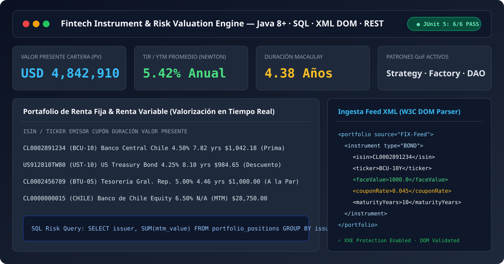
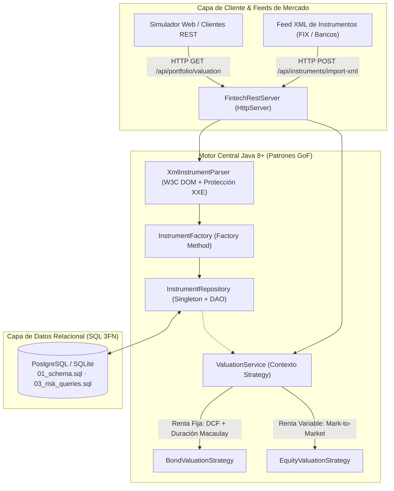
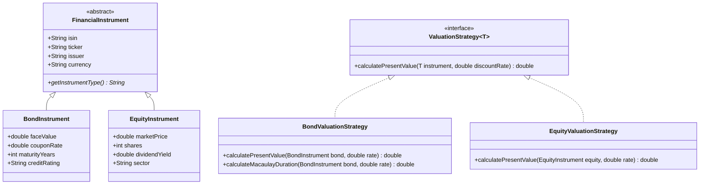

# 🏦 Fintech Financial Instruments & Risk Valuation Platform

[](https://www.oracle.com/java/)
[](https://gradle.org/)
[-25A162?logo=junit5&logoColor=white)](./tests)
[](./sql)
[](https://juancovili.github.io/fintech-instrument-service/)

> Plataforma backend de servicios financieros (*Front to Back to Risk*) para **valorización de instrumentos de Renta Fija (Bonos: Valor Presente, TIR/YTM y Duración de Macaulay) y Renta Variable**, ingesta segura de feeds de mercado en **XML (W3C DOM)**, persistencia relacional en **SQL** y exposición mediante **API REST** en **Java 8+** aplicando **Patrones de Diseño GoF**.

🔗 **[Probar Simulador Interactivo en Vivo (GitHub Pages)](https://juancovili.github.io/fintech-instrument-service/)**



---

## 🏛️ Arquitectura del Sistema & Patrones de Diseño (GoF)

El motor desacopla las reglas matemáticas de mercado del transporte HTTP y la persistencia SQL mediante cuatro patrones de diseño clásicos:



### Diagrama de Clases (Polimorfismo & Strategy Pattern)



---

## 🧪 Suite de Pruebas Automatizadas ([`/tests`](./tests))

El proyecto incluye una suite de pruebas automatizadas en **JUnit 5** (disponible en [`/tests/FintechEngineTestSuite.java`](./tests/FintechEngineTestSuite.java) y `src/test/java/`):

| # | Caso de Prueba (`@Test`) | Validación Financiera / Técnica | Estado |
| :--- | :--- | :--- | :---: |
| **1** | `testBondAtParValuation` | Bono a la par: cuando `tasa cupón (5%) == tasa de descuento (5%)`, el Valor Presente es exactamente igual al Nominal (`1000.00`). | ✅ PASS |
| **2** | `testBondInverseInterestRateRelationship` | Relación inversa precio/tasa: verifica cotización **Sobre la Par (Con Prima)** ante caída de tasas y **Bajo la Par (Con Descuento)** ante alza de tasas. | ✅ PASS |
| **3** | `testMacaulayDurationBounds` | Verifica el cálculo de **Duración de Macaulay** ponderada por flujos descontados ($0 < D < T$). | ✅ PASS |
| **4** | `testEquityValuationStrategy` | Verifica valorización *Mark-to-Market* de posiciones accionarias con el **Patrón Strategy**. | ✅ PASS |
| **5** | `testValidXmlIngestion` | Verifica el parseo W3C DOM de carteras XML y creación polimórfica con `InstrumentFactory`. | ✅ PASS |
| **6** | `testMalformedXmlThrowsControlledException` | Verifica rechazo seguro de XML corrupto y bloqueo de entidades externas (`XXE`). | ✅ PASS |

```bash
# Ejecutar todas las pruebas unitarias
./gradlew test
```

---

## 🗄️ Modelo Relacional SQL & Consultas de Riesgo ([`/sql`](./sql))

* **[`sql/01_schema.sql`](./sql/01_schema.sql):** Tablas normalizadas (`portfolios`, `financial_instruments`, `portfolio_positions`, `market_prices`) con claves foráneas e índices.
* **[`sql/02_seed_data.sql`](./sql/02_seed_data.sql):** Datos semilla con bonos soberanos y corporativos (`BCU-10Y`, `UST-10Y`, `Banco de Chile`, `SQM`).
* **[`sql/03_risk_queries.sql`](./sql/03_risk_queries.sql):** Consultas analíticas con `INNER JOIN`, `GROUP BY` y funciones de agregación para **Mark-to-Market (MTM)**, **PnL no realizado** y **concentración de exposición por emisor**.

---

## 🚀 Ejecución Local y con Docker

```bash
# Opción 1: Ejecutar con Gradle (Java 8+)
./gradlew run

# Opción 2: Construir y ejecutar con Docker Multi-Stage
docker build -t fintech-instrument-service .
docker run -p 8080:8080 fintech-instrument-service
```

---

## 👨‍💻 Autor

**Juan Covili**  
*Ingeniero en Informática / Analista Programador (INACAP)*  
* [LinkedIn](https://www.linkedin.com/in/juan-covili-59b935241/) · [GitHub](https://github.com/juanCovili) · [Portafolio Web](https://www.juancovili.com)
