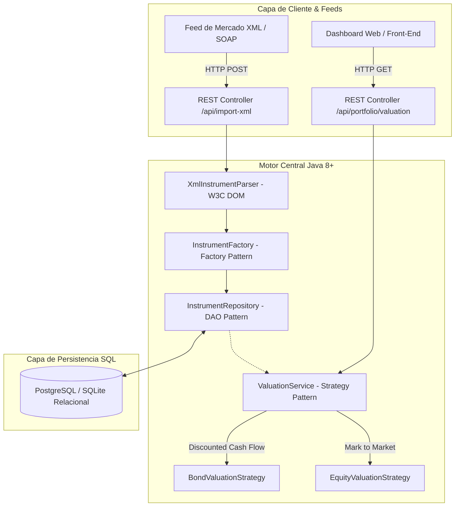

# Fintech Financial Instruments & Risk Valuation Platform

[](https://www.oracle.com/java/)
[](https://gradle.org/)
[](https://www.docker.com/)
[](https://www.postgresql.org/)
[](LICENSE)

> Plataforma backend de servicios financieros para valoración de carteras de inversión (*Front to Back to Risk*), ingesta de feeds de mercado en formato **XML/JSON**, cálculo de riesgo y persistencia relacional en **SQL**, construida con **Java 8+**, **Patrones de Diseño** y arquitectura desacoplada.

---

## 🏛️ Arquitectura del Sistema

El sistema implementa una arquitectura orientada a servicios (SOA / RESTful) con desacoplamiento entre las reglas financieras, el modelo de datos y los protocolos de transporte:



---

## 🎯 Requisitos Técnicos y Cobertura

Este proyecto cubre los requerimientos clave de ingeniería para plataformas financieras:

| Requerimiento | Implementación en este proyecto |
| :--- | :--- |
| **Java (Java 8+)** | POO pura, Colecciones genéricas, Streams API, multi-threading seguro con `CopyOnWriteArrayList`. |
| **Patrones de Diseño** | **Strategy Pattern** (algoritmos de descuento de bonos vs acciones), **Factory Pattern** (creación de instrumentos), **Repository / DAO** (persistencia). |
| **Formato XML** | Ingesta y validación de feeds de instrumentos financieros mediante `javax.xml.parsers.DocumentBuilder` y W3C DOM. |
| **Servicios Web (REST)** | Endpoints RESTful con soporte CORS, payloads JSON y parseo de XML. |
| **Base de Datos SQL** | Esquema en 3FN (`01_schema.sql`), semillas (`02_seed_data.sql`) y consultas avanzadas de exposición y concentración de riesgo (`03_risk_queries.sql`). |
| **Control de Versiones & DevOps** | Flujo Git profesional, `.gitignore` estricto y despliegue portable mediante **Docker** multi-stage. |

---

## 🗄️ Modelo Relacional SQL & Consultas Financieras

El directorio `/sql` contiene el esquema de base de datos relacional:

1. **`01_schema.sql`**: Tablas `portfolios`, `financial_instruments`, `portfolio_positions` y `market_prices` con claves foráneas e índices de rendimiento.
2. **`02_seed_data.sql`**: Datos semilla con instrumentos reales (Bonos Banco Central BCU-10Y, Bonos del Tesoro EE.UU. T-10Y, Banco de Chile, SQM).
3. **`03_risk_queries.sql`**: Consultas analíticas:
   * **Mark-to-Market (MTM) y PnL No Realizado:** Cálculo del rendimiento y variación frente al costo de adquisición.
   * **Concentración de Riesgo por Emisor:** Cálculo del porcentaje de exposición de la cartera por emisor y tipo de activo.

---

## 🚀 Cómo Ejecutar el Proyecto

### Opción 1: Con Docker (Recomendado)
```bash
# Construir la imagen
docker build -t fintech-core-service .

# Ejecutar el contenedor en el puerto 8080
docker run -p 8080:8080 fintech-core-service
```

### Opción 2: Con Gradle / Java Local
```bash
# Compilar y ejecutar
./gradlew run
```

---

## 📡 Endpoints de la API REST

Una vez en ejecución en `http://localhost:8080`:

| Método | Endpoint | Descripción | Formato |
| :--- | :--- | :--- | :--- |
| `GET` | `/health` | Chequeo de estado del servicio | JSON |
| `GET` | `/api/instruments` | Obtener todos los instrumentos de la cartera | JSON |
| `GET` | `/api/portfolio/valuation?rate=0.05` | Valoración total con tasa de descuento (Strategy Pattern) | JSON |
| `POST` | `/api/instruments/import-xml` | Importar lote de instrumentos en formato XML | XML -> JSON |

---

## 🌐 Demo Web Interactiva

Puedes interactuar con el simulador de valoración y parseo XML en el dashboard web disponible en la carpeta `/docs` (compatible con GitHub Pages y Cloudflare Pages).

---

## 👨‍💻 Autor
**Juan Andrés Covili Cabezas**  
*Ingeniero en Informática / Analista Programador (INACAP)*  
* Santiago, Chile  
* [LinkedIn](https://linkedin.com/in/juan-covili) · [GitHub](https://github.com/juanCovili) · [Sitio Web](https://juancovili.com)
